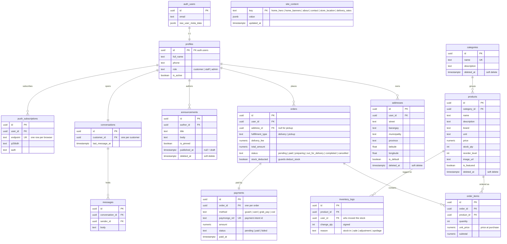

# ER diagram

The 13 tables from blueprint 5.2, exactly as `database/migrations/001_schema.sql` creates
them. GitHub and most editors render the Mermaid block below; no external tool is needed.

♻ marks a table with `deleted_at` (soft delete, FR-23). `auth.users` belongs to Supabase
Auth and is shown for the relationships only.

Notes that the diagram cannot show:

- **RLS is on for all 13 tables**, and every policy is scoped `to authenticated`, so the
  anonymous key reads nothing at all (`database/tests/rls.test.mjs`). The API uses the
  service role, which bypasses RLS.
- **Indexes** (blueprint 5.2, deliberately no more): `products(category_id)`,
  `orders(user_id, status)`, `inventory_logs(product_id)`,
  `messages(conversation_id, created_at)`.
- **Orders are never deleted**, they are cancelled; **users are deactivated**
  (`is_active = false`), not deleted. Soft delete covers products, categories,
  announcements and addresses.
- `order_items.unit_price` and `order_items.subtotal` are stored because a product's price
  can change after the sale; `orders.stock_deducted` is what makes `deduct_stock`
  idempotent against PayMongo retries.
